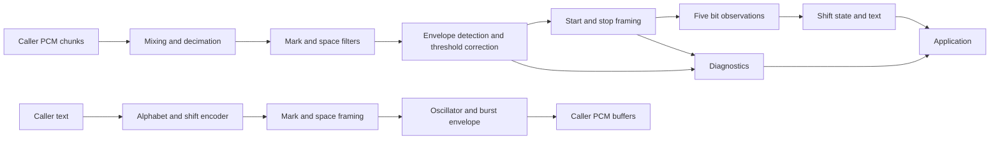

# go-rtty Design

- Status: design contracts; configuration and finite text encoding implemented.
- Date: 2 November 2026.
- Module: `github.com/ColonelBlimp/go-rtty`.
- Public package: `github.com/ColonelBlimp/go-rtty/rtty`.
- Project license: `GPL-3.0-only`, matching `go-ft8`.

`go-rtty` will provide a stateful RTTY receiver, a text and framing codec,
and a streaming AFSK transmitter for Go applications. Applications will supply
and consume mono PCM audio and retain responsibility for audio devices,
radio control, PTT, presentation, and logging.

The implementation will follow the development path established by `go-ft8`:
Go protocol code, reference implementations and labelled recordings for
validation, checked public APIs, explicit diagnostics, profiling before native
optimization, and a working pure-Go build. A small CGO backend remains an
option if measurements justify it. Extracting an entire application modem is
an alternative to evaluate if the Go receiver cannot meet the reception gates.

RTTY requires a different integration contract from FT8. It receives a
continuous sequence of asynchronous characters, with filter, timing, and
letters/figures state that must persist across calls. Ordinary five-bit RTTY
has no CRC or forward error correction: a correctly framed character is an
observation, not a verified message.

The APIs, thresholds, release stages, and performance numbers below are design
contracts and proposed acceptance targets. They are not implementation or
benchmark results.

Implementation status (4 November 2026): the reference foundation provides
pinned tools, protocol/audio fixtures, external corpus workflows, artifact
checks, Task commands, and a CI definition. The public `rtty` package implements
configuration/enums, tone calculations, option validation, finite US text
encoding, and typed configuration/option/input/text errors. Framing, receive
DSP, and transmit generation remain unimplemented. The [validation record](REFERENCE.md) describes
the checks actually run and the outstanding labelled-HF-corpus work.

## Relationship to go-ft8

The baseline is the local `go-ft8` tree at
[`cb9e03f171508232d7b1d25cf7323f58a5748233`](https://github.com/ColonelBlimp/go-ft8/tree/cb9e03f171508232d7b1d25cf7323f58a5748233).
Its [README](https://github.com/ColonelBlimp/go-ft8/blob/cb9e03f171508232d7b1d25cf7323f58a5748233/README.md),
[package contract](https://github.com/ColonelBlimp/go-ft8/blob/cb9e03f171508232d7b1d25cf7323f58a5748233/ft8/doc.go),
and [development tasks](https://github.com/ColonelBlimp/go-ft8/blob/cb9e03f171508232d7b1d25cf7323f58a5748233/Taskfile.yml)
establish the conventions to carry forward.

| Area | go-ft8 convention | go-rtty design |
| --- | --- | --- |
| Package boundary | Protocol library independent of station application | Same boundary, with a separate waveform generator |
| Go and CGO | Go codec; native DSP acceleration with a Go fallback | Go baseline; add native DSP only after a measured benefit |
| Input | Mono signed 16-bit PCM, timed slots | Mono signed 16-bit PCM, continuous ordered chunks |
| State | Decoder per receiver stream | Decoder per selected signal and uninterrupted sample stream |
| Results | Payload, text interpretation, provenance, diagnostics | Five-bit code, text interpretation, shift provenance, diagnostics |
| Validation | Reference decoder, vectors, corpus, checked errors | Independent transmitters and receivers, vectors, labelled corpus |
| Performance | Reproducible benchmarks and profiles | Processing time, character latency, allocations, sustained streams |
| Development | Task commands, Go tests, race checks, version.txt | Same workflow with RTTY-specific checks |
| Licensing | GPL-3.0-only and explicit upstream provenance | GPL-3.0-only and explicit upstream provenance |

There is no runtime dependency on `go-ft8`. In particular, its FT8 RTTY Roundup
message format is an FT8 payload format, not an audio RTTY modem, and provides
no modem core to reuse here.

## Scope and release boundaries

### First usable release

Version 0.1 will support one selected signal per decoder, the common
45-baud amateur profile, continuous receive, and both finite and interactive
AFSK transmission. It will expose raw character codes and deterministic
text handling, support normal and reversed tone assignments, and run with
`CGO_ENABLED=0`.

| Property | Version 0.1 contract |
| --- | --- |
| PCM | Mono `[]int16`; 12,000 or 48,000 samples per second |
| Baud rate | Exact `500/11` baud default; explicit `909/20` compatibility setting |
| Shift | 170 Hz |
| Data | Five bits, least significant bit first, no parity |
| Framing | One space start bit; 1.5 or 2 mark stop bits |
| Alphabet | Explicit US teleprinter figures table |
| Receive tuning | Caller-selected audio center; fixed frequency |
| Polarity | Explicit mark-high or mark-low audio assignment |
| Receive output | Ordered character/control observations and diagnostics |
| Transmit output | Timed mark/space symbols and pull-based PCM |
| Dependencies | Go standard library unless an evaluated DSP dependency is needed |

The conventional label 45.45 baud is rounded. `500/11` is approximately
45.454545 baud; `909/20` is exactly 45.45 baud. Both are accepted explicitly
so reference-generator rounding does not silently redefine the preset.
Minimodem's RTTY mode provides an independent 45.45-baud, five-bit,
1.5-stop-bit implementation for comparison.
[Minimodem mode and framing source](https://github.com/kamalmostafa/minimodem/blob/master/src/minimodem.c).

### Later extensions

Version 0.2 is the proposed reception and interoperability expansion: 50 and
75 baud, 425 and 850 Hz shifts, an explicitly specified international ITA2
table, bounded automatic frequency control, and stronger fading/interference
performance. Each new combination receives its own fixtures and acceptance
results. Version 0.1 rejects these configurations rather than accepting
untested values.

Support for 8 kHz and 44.1 kHz input requires a separately tested rational
resampler or a documented caller-side conversion. It is deferred. The first
two sample rates permit straightforward integer decimation after mixing.

Broadband signal discovery, simultaneous channel decoding inside one instance,
automatic polarity selection, diversity reception, direct serial/GPIO FSK,
ASCII modes, weather-message parsing, contest exchange parsing, and radio
control are outside the initial scope. Independent instances can decode
multiple caller-selected channels.

## Protocol and text contract

### Mark and space

The logical convention is fixed: mark is one, space is zero, idle is mark,
the start bit is space, and stop bits are mark. Polarity selects the audio
tone assigned to each logical state; it does not invert the decoded codeword
after framing.

With center frequency `fc` and shift `s`, the two audio frequencies are
`fc - s/2` and `fc + s/2`. `MarkHigh` assigns mark to the higher frequency;
`MarkLow` assigns it to the lower frequency. The default is `fc = 1500 Hz`,
`s = 170 Hz`, and `MarkHigh`: mark 1585 Hz, space 1415 Hz.

These definitions describe audio only. The application maps USB/LSB and radio
FSK conventions to the required audio polarity. The library does not infer
sideband from frequency or transceiver mode.

### Character framing and timing

A frame is one start bit, five data bits, and the selected stop interval.
The data bits of a code value are transmitted in the order bit 0 through bit 4.
At `500/11` baud, one bit lasts exactly 22 ms and a 1.5-stop-bit frame lasts
165 ms. Shift codes take a full frame and reduce printable throughput.

Use integer half-bit durations for protocol symbols: a start or data bit is
two half-bits; stop intervals are three or four. A rational sample clock
converts cumulative half-bit time to output samples. Do not round each bit
independently. Input chunk boundaries and output buffer boundaries never
restart a symbol clock or oscillator.

For baud numerator `p`, denominator `q`, sample rate `Fs`, and cumulative
half-bit count `H`, the nominal boundary is:

```text
sampleBoundary(H) = floor(H * Fs * q / (2 * p))
```

Implement this with a bounded remainder accumulator, not an ever-growing
product. Total timing error stays below one sample. This is also important at
the proposed 1200 Hz internal receive rate, where a default bit spans 26.4
samples.

### Alphabet and shift state

The first alphabet is named `AlphabetUS`, not an unspecified universal Baudot
table. International ITA2 and national teleprinter tables differ in figures
positions. The US mapping below matches the explicit US table in
[fldigi's RTTY source](https://github.com/w1hkj/fldigi/blob/master/src/cw_rtty/rtty.cxx).
An international profile must be specified independently against
[ITU-T S.1](https://www.itu.int/rec/T-REC-S.1-199303-I), including national-use
positions.

| Code | Letters | US figures | Code | Letters | US figures |
| ---: | --- | --- | ---: | --- | --- |
| 0 | NUL | NUL | 16 | T | 5 |
| 1 | E | 3 | 17 | Z | double quote |
| 2 | LF | LF | 18 | L | ) |
| 3 | A | - | 19 | W | 2 |
| 4 | SPACE | SPACE | 20 | H | # |
| 5 | S | BEL | 21 | Y | 6 |
| 6 | I | 8 | 22 | P | 0 |
| 7 | U | 7 | 23 | Q | 1 |
| 8 | CR | CR | 24 | O | 9 |
| 9 | D | $ | 25 | B | ? |
| 10 | R | 4 | 26 | G | & |
| 11 | J | apostrophe | 27 | FIGS | FIGS |
| 12 | N | , | 28 | M | . |
| 13 | F | ! | 29 | X | / |
| 14 | C | : | 30 | V | ; |
| 15 | K | ( | 31 | LTRS | LTRS |

The receiver starts in letters state with `ShiftSourceAssumed`. Valid LTRS
or FIGS codes establish explicit state. Receive unshift-on-space, `USOS`, is
an option, initially disabled. When enabled, SPACE switches the interpretation
to letters and marks the source `ShiftSourceUSOS`. CR and LF do not implicitly
change state in this profile.

This is a deliberate project default, not an assumption about another modem.
The fldigi configuration source examined during design review sets both
`UOSrx` and `UOStx` to true. Reference fixtures must explicitly set and record
receive and transmit USOS independently, verify the settings in the pinned
build, and exercise both receive policies. Never compare unspecified defaults.
[Fldigi configuration source](https://github.com/w1hkj/fldigi/blob/master/src/include/configuration.h).

A continuous carrier pause preserves shift state. After declared carrier loss,
the next acquisition starts with assumed letters. An explicit stream reset
does the same. Joining a transmission in progress may therefore produce
incorrect text until a shift code arrives; raw codes and shift provenance
allow the application to explain that uncertainty.

The transmitter sends LTRS at the beginning of each nonempty transmission.
It emits shifts when required and repeats FIGS before the first figure after
a SPACE, even if its own previous state was figures. This makes its output
work with receivers that enable USOS and those that do not. Repeated LTRS or
FIGS codes are permitted and must not become printable spaces.

For example, `A1A` encodes as `[31, 3, 27, 23, 31, 3]`: LTRS, A, FIGS,
1, LTRS, A. Code 3 has data bits `1, 1, 0, 0, 0` on the wire. With 1.5 stop
bits its complete frame is a space start for two half-bits, those five data
bits for two half-bits each, and mark stop for three half-bits. The six frames
take 990 ms at the default baud rate, excluding lead-in and tail.

### Text normalization

The public text encoder accepts valid UTF-8, uppercases ASCII `a` through `z`,
and otherwise uses the selected table exactly. Unsupported runes, including
typographic quotation marks and non-ASCII letters in `AlphabetUS`, produce a
typed error with the byte offset and rune. There is no silent substitution,
transliteration, punctuation aliasing, or dropped character.

CR, LF, and SPACE remain distinct. A literal LF encodes LF, and CRLF encodes
both controls. Callers choose line-ending policy before encoding. This avoids
changing output when CR and LF arrive in separate `QueueText` calls. Tabs and
backspace are unsupported. NUL and BEL are accepted as their explicit controls.

On receive, printable characters, SPACE, CR, and LF contribute to `Text`.
NUL, BEL, LTRS, and FIGS produce control observations with empty text. BEL does
not trigger a sound or terminal action. No line assembly or duplicate-message
suppression occurs in the codec.

## Architecture



Protocol code, text handling, options, errors, and results live in `rtty`.
DSP primitives and optional native bindings remain internal. The application
does not depend on filter types or a native ABI.

The initial implementation uses synchronous calls and per-instance state.
There are no hidden goroutines, timers, device handles, network connections,
or process-global mutable modem settings. Processing the same samples has
the same outcome regardless of the wall-clock pace of calls.

## Public API

The configuration, option validation, and finite text encoding APIs below are
implemented and documented in package GoDoc. Receiver, frame-symbol, and
transmitter sketches define the proposed surface and semantics for later work.

### Configuration

```go
type BaudRate struct {
    Numerator   uint32
    Denominator uint32
}

type Config struct {
    SampleRate int
    Baud       BaudRate
    CenterHz   float64
    ShiftHz    float64
    Polarity   Polarity
    StopBits   StopBits
    Alphabet   Alphabet
}

func DefaultConfig() Config
func (c Config) Validate() error
func (c Config) ToneFrequencies() (markHz, spaceHz float64, err error)

type DecoderOptions struct {
    USOS    bool
    Squelch SquelchOptions
}

type SquelchOptions struct {
    Enabled  bool
    OpenDB   float64
    CloseDB  float64
    HangBits uint32
}

func DefaultDecoderOptions() DecoderOptions
func (o DecoderOptions) Validate() error
```

`Polarity`, `StopBits`, and `Alphabet` have underlying type `uint8`; zero and
unknown values are invalid. The supported constants are `MarkHigh = 1`,
`MarkLow = 2`, `StopBitsOnePointFive = 3`, `StopBitsTwo = 4`, and `AlphabetUS = 1`.
Stop values count half-bits. The US mapping is implemented by the text encoder;
framing remains planned.

`DefaultConfig` supplies the version 0.1 values listed above, including 12 kHz
PCM and 1.5 stop bits. Constructors require explicit valid configuration;
`Config{}` is invalid. Options are also explicit: a zero `DecoderOptions`
disables USOS and squelch, while `DefaultDecoderOptions` enables squelch.
No constructor silently repairs an unknown enum or unsupported configuration.
All GoDoc, README, and integration examples must start with `DefaultConfig()`
and `DefaultDecoderOptions()`. To disable squelch deliberately, modify the
returned options with `opts.Squelch.Enabled = false`. Document zero options
as an explicit ungated receive mode and test it separately from the recommended
defaults; it is not shorthand for those defaults.

Validate finite frequencies and thresholds, nonzero baud terms, the supported
rate/shift/sample-rate combinations, and valid enums. Compare reduced rational
baud values without modifying the caller's config. Require each tone and the
detector's guard bands to fit the input passband: both tones must lie in
`[300, SampleRate/2 - 300]` Hz, including the endpoints. With squelch enabled, require
`0 <= CloseDB < OpenDB <= 40` and `1 <= HangBits <= 100`.
With squelch disabled, thresholds must still be finite, but their ranges and
the hang interval are ignored. Both validation methods return the first invalid
field and leave the supplied value unchanged. `ToneFrequencies` validates the
complete config and returns zero frequencies on error.

Initial squelch tuning candidates are 6 dB open, 3 dB close, and eight bits of
hang time. These values describe tone energy relative to the detector's local
noise estimate, not FT8-style SNR. The corpus gate must establish the shipped
defaults and version their metric definition.

### Receiver

```go
func NewDecoder(cfg Config, opts DecoderOptions) (*Decoder, error)

func (d *Decoder) Process(pcm []int16) (DecodeReport, error)
func (d *Decoder) Flush() (DecodeReport, error)
func (d *Decoder) Reset(nextSample int64) error
func (d *Decoder) Close() error

type DecodeReport struct {
    Generation   uint64
    InputStart   int64
    InputEnd     int64
    Observations []Observation
    Text         string
    Diagnostics  DecodeDiagnostics
    Signal       SignalMetrics
}

type Observation struct {
    Code        uint8
    Kind        ObservationKind
    Text        string
    StartSample float64
    EndSample   float64
    Shift       ShiftState
    ShiftSource ShiftSource
    Confidence  float64
}

type DecodeDiagnostics struct {
    InputSamples       uint64
    AcceptedFrames     uint64
    PrintableChars     uint64
    ControlCodes       uint64
    RejectedStarts     uint64
    FramingErrors      uint64
    CarrierAcquisitions uint64
    CarrierLosses      uint64
    DiscardedPartialFrames uint64
    ClippedSamples     uint64
}

type Estimate struct {
    Value float64
    Valid bool
}

type SignalMetrics struct {
    CarrierPresent   bool
    LevelDBFS        Estimate
    ToneToNoiseDB    Estimate
    MarkSpaceRatioDB Estimate
}
```

`Kind` distinguishes printable characters, SPACE, CR, LF, NUL, BEL, LTRS,
and FIGS. `Shift` is the interpretation state after this observation; for a
printable code it is also the state used to render it. `ShiftSource` identifies
assumed, explicit, or USOS state. Failed frames do not update shift state.

`InputStart` and `InputEnd` are the half-open input sample range consumed by
this call. A new decoder begins at zero. Observation times are fractional
positions in that original PCM timeline, corrected for known DSP delay.
They denote the estimated start transition and end of the accepted stop
interval, not the time the application receives the report. The stop end is
the nominal boundary, or a validated earlier next-start edge inside the
specified tolerance. Delayed observations may refer to samples consumed by
an earlier call.

Diagnostics are per-call deltas, so they can be summed across chunks.
AcceptedFrames includes every returned code. PrintableChars includes SPACE
but excludes CR/LF and the other controls; ControlCodes counts those remaining
accepted codes. DiscardedPartialFrames covers carrier-loss and flush disposal.
An explicit Reset is an application-recorded discontinuity and does not return
diagnostics for the discarded generation.
Signal metrics are snapshots on the internal sample clock; snapshots need not
match between different chunk partitions because their observation times
differ. `Text` is exactly the concatenation of observation text in this report.

`Confidence` is a bounded demodulation quality score, initially the minimum
normalized separation of the accepted start, data, and stop decisions. It is
not a calibrated probability of correctness. Valid framing does not prove
correct character data, and a wrong shift can make a high-quality code render
as the wrong character.

### Receiver lifecycle and ownership

| Operation or condition | Required behavior |
| --- | --- |
| `Process` | Consume the complete input synchronously or reject before changing state |
| Empty input | No-op with an empty range, zero diagnostic deltas, and current signal snapshot |
| Arbitrary chunk lengths | Preserve filters, timing, shift state, and partially received frames |
| No carrier or no complete character | Successful report with zero observations |
| Bad framing | Count a diagnostic; emit no character for that candidate |
| `Flush` | Finish processing real buffered input, discard incomplete frames, enter ended state |
| Repeated `Flush` | Successful empty report; never repeat observations |
| `Process` after `Flush` | Return `ErrEnded` until reset |
| `Reset(nextSample)` | Validate a nonnegative origin, clear all receive state, increment generation, start a new segment |
| `Close` | Release resources, drop pending work, and become permanently closed; idempotent |
| Operations after close | Return `ErrClosed`, except repeated close |

Flush must not append synthetic mark, silence, or zeros to manufacture a
complete final character. Audio fixtures and transmit bursts contain real
trailing mark sufficient for the selected receive filter delay. At a truncated
recording boundary the correct result can be a discarded partial frame.

Reset clears filter history, phase, timing, carrier tracking, shift state,
metrics, and pending observations. A known audio gap uses the actual next
sample position; an unknown gap starts a new application timeline and can
reset to zero. Generation distinguishes repeated sample positions. The caller
records gap length and reason; the decoder cannot infer missing samples from
the timing of `Process` calls.

PCM input is borrowed only for the call. Returned slices and strings remain
owned by the caller and valid after later calls. Decoder state is bounded;
the returned observations necessarily use space proportional to the number
of accepted characters in the supplied input. Process large slices in bounded
internal blocks without retaining the input.

Methods on one instance must not run concurrently, including Reset and Close.
Lifecycle checks precede input handling: an empty Process call on an ended
or closed decoder still returns the appropriate lifecycle error.
Different instances are independent and may run concurrently. Configuration is
immutable for an instance. Retuning constructs a new decoder and a new
application stream segment; it never reuses stale filter history implicitly.

### Protocol encoding

```go
type TextOptions struct {
    Alphabet Alphabet
}

type EncodedText struct {
    Text  string
    Codes []uint8
}

type Symbol struct {
    Mark     bool
    HalfBits uint32
}

func EncodeText(text string, opts TextOptions) (EncodedText, error)
func (o TextOptions) Validate() error
func FrameCodes(codes []uint8, stop StopBits) ([]Symbol, error)
```

`EncodeText` is a finite, stateless convenience encoder. Nonempty output starts
with LTRS and includes all required shifts, including the FIGS repetition
after SPACE. `EncodedText.Text` is the normalized source text; `Codes` is the
actual transmitted sequence, including shifts. Empty input returns empty
output. Validation of the entire input precedes output commitment.

`TextOptions` requires explicit `AlphabetUS`; zero options are invalid, including
for empty input. Options are checked first, then the complete input's UTF-8
validity, then representability in the selected alphabet. Malformed UTF-8
returns `*InvalidUTF8Error` at the first invalid byte, even when an earlier
valid rune is unsupported. Otherwise the first unsupported rune returns
`*UnsupportedTextError` with the original rune and byte offset. A correctly
encoded U+FFFD is unsupported text rather than malformed UTF-8. Literal ASCII
ESC and US do not request FIGS/LTRS and are rejected as unsupported text.

The result is caller-owned. Empty input and all errors return the zero
`EncodedText`, including nil `Codes`; errors never expose a partial encoding.
No state is shared between calls. `EncodeText` and `TextOptions.Validate` are
implemented; `Symbol` and `FrameCodes` remain the next protocol milestone.

`FrameCodes` rejects values above 31 and invalid stop selections. It adds
framing to the supplied codes without inserting shifts, lead-in, or tail.
The output is canonical and uncoalesced: exactly seven entries per code, in
order, for start, data bits 0 through 4, and stop. Start and data entries have
`HalfBits=2`; the stop entry has `HalfBits=3` or `4`. Adjacent identical states
remain separate, including across characters. Empty input returns no entries.
Internal rendering may combine runs without changing this public result.
This protocol output supports analysis and a future hardware FSK adapter;
the adapter would own wall-clock scheduling and electrical polarity.

### Streaming transmitter

```go
type TransmitterOptions struct {
    Amplitude      float64
    LeadIn         time.Duration
    Tail           time.Duration
    Ramp           time.Duration
    MaxQueuedCodes int
}

func DefaultTransmitterOptions() TransmitterOptions
func NewTransmitter(cfg Config, opts TransmitterOptions) (*Transmitter, error)
func (t *Transmitter) QueueText(text string) error
func (t *Transmitter) ReadPCM(dst []int16) (n int, err error)
func (t *Transmitter) End() error
func (t *Transmitter) Close() error
```

The proposed defaults are peak amplitude 0.5 of full scale, 250 ms lead-in,
150 ms tail, a 5 ms raised-cosine burst ramp, and capacity for 4096 codes.
Lead-in and tail include their respective ramps. Validate finite amplitude in
`(0, 1]`, durations in `[0, 10 s]`, ramp at most half of both lead-in and tail,
and queue capacity from 1 through 65536 codes. Zero ramp is an explicit
diagnostic option outside the qualified transmit profile.
The default tail leaves margin beyond the proposed 100 ms receive-filter
delay. Applications selecting a shorter tail take responsibility for the
receivers and buffering involved; independent receiver tests qualify the
shipped default.

Queue capacity counts pending data and shift frames; it excludes the currently
rendering frame and fixed lead/tail states. `QueueText` validates and computes
the complete addition before updating the queue or encoder state. Unsupported
text and `ErrQueueFull` leave both unchanged. Count required codes before
allocating, so a very large rejected request does not allocate a second copy.

Before the first nonempty queue operation, `ReadPCM` returns `(0,
ErrWouldBlock)`. The first queued text starts one transmission: ramped mark
lead-in, initial LTRS, and framed codes. Once active, an empty queue generates
continuous mark until more text arrives or End is called. Queue boundaries
do not insert extra lead-ins, reset letters/figures, or reset oscillator phase.

Version 0.1 has no idle or total-transmission timeout. If the producer stops
queuing text and never calls End or Close, continued ReadPCM calls produce
mark indefinitely; queue capacity does not bound transmission duration. The
application must enforce its own total-transmission deadline and PTT stop
path, including producer failure and audio-loop failure. A library timeout is
deferred and would not replace that independent application responsibility.

`End` is idempotent and rejects further text with `ErrEnded`. It allows all
queued frames and their full stop intervals to finish, then emits the tail
and ramp-down. End before any text produces an empty transmission. ReadPCM
returns the remaining samples with `io.EOF` when complete, and `(0, io.EOF)`
thereafter. Callers must handle `n > 0` before handling EOF.

An empty destination is a no-op while open and returns `(0, nil)`. Close drops
pending output immediately and is idempotent. A new transmission uses a new
instance. Closing does not retract audio already copied into an application
or device buffer.

The application serializes QueueText, ReadPCM, End, and Close. A bounded queue
allows producer backpressure without hidden blocking. The library never
sleeps to maintain baud timing: sample positions determine timing, and the
audio device determines playback pace.

### Errors

The implemented APIs export `ErrInvalidConfig`, `ErrInvalidOptions`,
`ErrInvalidInput`, and `ErrUnsupportedText`. `*ConfigError` and `*OptionsError` expose `Field` (the Go
field path, such as `Baud.Numerator` or `Squelch.OpenDB`) and `Reason`, and unwrap
to the respective sentinel. Human-readable reason/error strings are not stable
machine-readable identifiers. `*InvalidUTF8Error` exposes `ByteOffset` and
unwraps to `ErrInvalidInput`. `*UnsupportedTextError` exposes `Rune` and
`ByteOffset` and unwraps to `ErrUnsupportedText`. The remaining error categories
below are planned for the operations that use them.

Export sentinel errors for `ErrInvalidConfig`, `ErrInvalidOptions`,
`ErrInvalidInput`, `ErrUnsupportedText`, `ErrQueueFull`, `ErrWouldBlock`,
`ErrEnded`, and `ErrClosed`. Typed errors expose the field and reason,
unsupported rune and byte offset, or required and available queue capacity.
They support `errors.Is` and `errors.As`, following `go-ft8`'s checked API
convention.

Invalid configuration, invalid codes, sample-index overflow, and invalid reset
positions are rejected before state changes. Poor reception and framing
failures are diagnostics, not API errors. No permissive API will silently
pad audio, change baud rate, drop characters, or truncate text.

## Receive processing

### Conditioning and channel filters

Convert PCM to floating point using `sample / 32768.0`, retain headroom in
subsequent arithmetic, and count rail samples as possible clipping. Do not
apply per-chunk normalization. It would make decoding depend on callback
sizes and could destroy the relative amplitudes used for fading correction.

Mix independently around mark and space with continuous complex oscillators.
Apply identical anti-alias filters and integer decimation to a proposed
1200 Hz complex processing rate: factors 10 and 40 for 12 kHz and 48 kHz
input. Anti-alias attenuation must be verified with out-of-band tones before
any decimation stage. Filter and decimator phase persist between calls.

Prototype with direct FIR processing and a simple matched-filter reference.
Then evaluate baud-dependent Nyquist-style filters against the corpus. Equal
branch response and known group delay matter more than sharing FT8's FFT
backend. Introduce overlap-add FFT filtering only if profiling shows that
direct filtering is a meaningful cost.

The paired baseband-filter approach and selective-fading correction are
supported by [W7AY's ATC analysis](https://www.w7ay.net/site/Technical/ATC/).
Fldigi uses baseband filtering and an optimized ATC detector, making it a
useful quality reference.
[Fldigi receiver description](https://www.w1hkj.org/FldigiHelp/rtty_page.html).

### Detection and carrier gating

The reference discriminator compares equal-bandwidth mark and space energies:

```text
d = (Emark - Espace) / (Emark + Espace + epsilon)
```

The production detector evaluates envelope tracking and automatic threshold
correction against that reference. Track the branches independently; bound
normalization near the noise floor; avoid learning a false threshold during
long mark idle or long runs of a single bit value. ATC parameters evolve on
the sample clock, not once per Process call.

Squelch uses tone-to-noise evidence with hysteresis and bit-based hang time.
Estimate noise using equal-bandwidth guard measurements outside the two signal
branches; do not equate the weaker signal branch with noise during selective
fading. Prototype work must establish guard placement, equivalent noise
bandwidth, acquisition duration, and interference behavior. Those coefficients
and constants become versioned receiver parameters with regression fixtures.

Carrier gating and frame validation are separate. A steady mark tone may
establish carrier but produces no characters. Weak or clipped signals may
still yield valid-looking wrong characters. Do not add callsign dictionaries,
expected contest exchanges, or language correction to hide those errors.

### Start detection and clock recovery

The receive state machine is:

```text
Acquire mark -> Detect falling transition -> Validate start
             -> Sample five data bits -> Validate stop -> Emit
                         |                    |
                         +---- failure -------+-> Reacquire
```

Let `T` be the configured bit period, `t0` the interpolated start edge, and
`S` the configured number of stop bits. Initial acquisition and the handoff
between adjacent characters use different rules:

1. On initial acquisition, after carrier loss, or after rejected framing,
   require at least `1.0*T` of qualified mark before accepting a falling edge.
   Validate the candidate start with space evidence around `t0 + 0.5*T`.
2. Sample or integrate data near `t0 + (1.5 ... 5.5)*T`. Confirm stop mark
   over the interval `t0 + [6.25, 6.75]*T`, centered on the 6.5-bit check.
   Keep the resulting frame pending while testing the end of its stop.
3. Arm the next-start detector at `t0 + (6 + S - 0.20)*T`. A falling edge
   before this bound invalidates the pending frame. From this bound onward,
   the already confirmed stop supplies mark qualification; do not demand
   another acquisition interval. A next start must still pass the same
   half-bit space validation as an initial start.
4. The dense-traffic search window ends at `t0 + (6 + S + 0.20)*T`. If no
   edge arrives in that window, continue in mark idle and accept a later
   qualified falling edge without a timeout or a new lock-on delay.

Emit the pending frame when either mark evidence reaches its nominal end
`t0 + (6 + S)*T`, or an earlier next-start edge inside the permitted window
has passed start validation. In the latter case, use that edge as EndSample.
Do not require mark through the nominal end when a valid slightly faster
sender has already begun the next character. If an early edge fails its
start validation, reject the still-pending previous frame and reacquire.

The initial early/late window is 0.20 bit (4.4 ms at the default baud).
For 1.5 stop bits, the dense next-start interval is `[7.30, 7.70]*T`; for
2 stop bits it is `[7.80, 8.20]*T`. These are explicit receiver tolerances,
not changes to transmit framing. Clock-offset and shortened-stop fixtures
qualify or revise the numerical tolerances before release; the distinct
acquisition and inter-character rules remain part of the contract.

Reset phase at each accepted character start. This gives an asynchronous
receiver useful clock-error tolerance without needing a long uninterrupted
training sequence. A later bounded timing loop may refine the nominal period;
it must freeze during idle/fades and remain constrained around configured baud.

The decoder must detect the next start while completing the previous stop,
including back-to-back 1.5-stop-bit characters. A small ring of recent metrics
supports the pending frame, fractional decisions, next-start validation, and
recovery after rejected candidates. Candidate start positions advance
monotonically so rescanning cannot emit duplicates.

StopBits specifies the nominal stop interval, with the early-edge allowance
defined above; it does not demand that every received stop last exactly its
nominal duration. Longer mark intervals remain valid idle. Version 0.1 does not claim reception
of one-stop-bit transmitters. A framing failure does not synthesize a question
mark or guess a lost character; the diagnostic records the failure.

### Frequency tracking

Version 0.1 uses fixed tuning. Its acceptance tests establish the usable offset
range. It does not expose an AFC toggle that has no implementation.

Version 0.2 may add bounded AFC that applies a common offset to both tones,
preserves their separation, gates updates on reliable branch observations,
and limits both capture range and slew. It freezes during weak-carrier
intervals and reports estimated offset and whether the configured bound was
reached. One faded branch must not pull the center toward the surviving tone.

Initial AFC evaluation targets are a capture range of plus or minus 40 Hz
and common drift of 0.5 Hz per second. They are experimental targets until
validated with fading, adjacent signals, and long idle intervals. Automatic
polarity selection is a separate future feature.

## Transmit processing

The text encoder produces five-bit codes and shifts. The framer produces
logical mark/space intervals. The modulator maps those intervals to the
configured audio frequencies using one phase-continuous oscillator:

```text
phase[n+1] = wrap(phase[n] + 2*pi*frequency[n]/Fs)
sample[n]  = amplitude * envelope[n] * sin(phase[n])
```

Version 0.1 uses continuous-phase FSK with a 5 ms raised-cosine frequency
transition at each logical tone change. For a transition beginning at `tb`,
interpolate from the old tone `f0` to the new tone `f1` as:

```text
u = clamp((t - tb) / 0.005, 0, 1)
frequency(t) = f0 + (f1 - f0) * (1 - cos(pi*u)) / 2
```

This transition finishes well before the next possible data transition at
the initial baud rates. It changes frequency continuously while maintaining
oscillator phase and constant amplitude during the payload. Keep the separate
raised-cosine amplitude ramps at burst boundaries. Neither ramp state nor
oscillator phase restarts at a character or buffer boundary. The half-bit
symbol schedule is unchanged; the approximately 2.5 ms frequency-transition
midpoint delay must be included in waveform timing and interoperability tests.

PCM conversion is `clamp(roundToEven(32767 * sample[n]), -32768, 32767)`.
The scale is explicitly 32767, so an ideal amplitude-one waveform spans
`[-32767, 32767]` and never requires saturation. Saturation is defensive,
not normal waveform shaping. Receive normalization remains division by
32768; the small full-scale asymmetry is intentional. Test both extrema,
rounding ties, and buffer-invariant output.

This waveform deliberately has its own specification. Fldigi describes a
different, separately shaped two-tone modulation approach; interoperability
requires correct decoded data, not sample-for-sample equality with fldigi.
[Fldigi modulator description](https://www.w1hkj.org/FldigiHelp/rtty_page.html).
The 5 ms transition is the selected first candidate for the spectral gate
below, supported by a [preliminary waveform experiment](RTTY_TX_SPECTRUM.md).
It still requires independent-receiver qualification. If it fails either
interoperability or the spectral gate, revise shaping before releasing TX;
do not ship abrupt frequency switching as an unqualified fallback.

Measure tone frequency, transition timing, accumulated duration, burst
envelope, and out-of-band spectrum independently of the receiver. Retain
spectral plots and their measurement window/resolution for changes to shaping.
Do not equate 170 Hz shift with a complete occupied-bandwidth specification.

### Spectral acceptance

The following is an engineering gate on generated PCM for the 170-Hz,
45-baud profile. It is not a regulatory RF emission mask or a claim about
a radio's subsequent audio and RF chain. Reference all levels to the total
positive-frequency power of the same measured waveform, including any
out-of-band energy, rather than to the height of a single FFT bin.

| Measurement | Required maximum |
| --- | ---: |
| Combined power outside `fc +/- 250 Hz` | -40 dBc |
| Combined power outside `fc +/- 500 Hz` | -55 dBc |
| Power in any 10 Hz band wholly outside `fc +/- 250 Hz` | -45 dBc |

For steady payload, use at least 60 seconds per pattern, a periodic Hann
window of exactly one second, a one-second FFT, 50 percent overlap, and
arithmetic averaging of linear one-sided power spectra. Bin spacing is 1 Hz
and Hann equivalent noise bandwidth is 1.5 Hz. Integrate by bin-center
frequency with no smoothing or peak normalization. The 10 Hz mask scans every
ten-consecutive-bin interval wholly outside the specified central region.

Exercise every repeated five-bit code, the repeated 0-through-31 sequence,
seeded random codes, long idle followed by text, and representative text with
shifts. Cover both sample rates, both stop selections, both baud presets,
both polarities, multiple initial phases, and amplitudes 0.25, 0.5, and 1.0.
Include the default center, passband-boundary centers, and a center offset
by a fractional FFT bin. Do not average results across patterns to obtain a
pass. Both normal and interrupted-queue payloads must meet the mask.

Also measure whole finite bursts, including lead-in, tail, and amplitude
ramps, with a rectangular analysis window enclosing the complete burst and
zero-padding to give bin spacing at most 1 Hz. Apply the two integrated
out-of-band limits to energy ratios over the whole burst. This prevents a
payload-only Welch measurement from hiding key-up/down energy. Exercise
single-character and short mixed-text bursts as well as longer traffic.

The release gate qualifies the default burst settings. Nondefault ramp and
lead/tail combinations need the same qualification before being advertised
as transmit profiles; a zero-ramp diagnostic setting is not a qualified
profile. Retain numeric measurements and spectra with each waveform revision.
Stage 5 cannot pass on a visually narrow waterfall alone.

Queue partition invariance applies when the same text is available before
rendering reaches it: splitting a string across QueueText calls must produce
the same codes and PCM. If the queue runs empty during active rendering, the
additional idle mark is intentional elapsed transmission time.

## Go and CGO decision

### Recommended baseline

Implement the protocol and initial receiver in Go. Use fldigi as the primary
HF reception comparator and minimodem as a second, simpler interoperability
reference. The first milestone must obtain a repeatable reference workflow
and labelled test material before investing in receiver optimization.

| Approach | Benefit | Cost or constraint | Decision |
| --- | --- | --- | --- |
| Go protocol and DSP | Streaming state is visible; simple builds and tests | Receiver quality must be developed and measured | Baseline |
| Go with small native kernels | Can accelerate measured DSP hotspots | Toolchains, ABI, memory lifetime, backend testing | Add only with benchmark evidence |
| Extract fldigi modem core | Potential reuse of an established algorithm | Application dependencies, global settings, separation work | Evaluate if receiver quality stalls |
| Liquid-DSP primitives | Existing filters, oscillators, resamplers | Still requires a complete RTTY detector and protocol design | Optional experiment |
| Runtime subprocess modem | Fast experimental comparison | Process lifecycle, I/O buffering, installation dependency | Test harness only |

Liquid-DSP offers general DSP building blocks, rather than the complete API
defined here. [Liquid-DSP project](https://github.com/jgaeddert/liquid-dsp).
Fldigi's current RTTY source includes application-facing dependencies; the
existence of its modem does not establish that it can be wrapped unchanged as
a small standalone library.
[Fldigi modem source](https://github.com/w1hkj/fldigi/blob/master/src/cw_rtty/rtty.cxx).

Use the receiver corpus to decide algorithm changes and CPU profiles to decide
language changes. Moving the same detector to C does not by itself improve
weak-signal recovery. Reconsider a native modem extraction if the Go receiver
remains materially worse on required channel conditions after focused tuning.

### Native backend contract

If a native backend is adopted, keep it internal, pinned, and reproducible.
The native API uses opaque per-instance handles, primitive arrays, lengths,
and explicit status values. It exposes create, process, reset, and destroy
operations. There are no callbacks into Go, per-sample CGO calls, retained
Go slice/string pointers, or process-global mutable receiver state.

C receives borrowed pointer-free buffers only for the duration of a call and
owns any persistent native memory. Close releases that memory deterministically;
a finalizer can only be a leak fallback. C++ exceptions must not cross a C ABI.
These boundaries follow the [Go CGO pointer rules](https://pkg.go.dev/cmd/cgo#hdr-Passing_pointers).

Before enabling a backend by default, require a material measured benefit
(initial target: at least 20 percent lower end-to-end receive CPU time), the
same accepted codes and controls on the locked corpus, bounded numeric
differences in diagnostics, and documented toolchain support. A backend that
changes the reception algorithm is evaluated as a separate algorithm, not
described as numerically equivalent acceleration.

The proposed eventual build selection is native for `cgo && !purego` only on
supported targets, and Go for `!cgo || purego` or unsupported targets. Until a
native backend earns inclusion, all builds use Go. The `purego` build tag
selects the Go DSP path while allowing `-race`, which itself requires CGO on
supported platforms. Do not introduce Gonum or PocketFFT solely to reproduce
the FT8 dependency list.

## Diagnostics and integration

Metrics distinguish no carrier, rejected starts, framing errors, control
traffic, and actual printable output. LevelDBFS measures PCM RMS relative to
full-scale amplitude. MarkSpaceRatioDB compares independently tracked branch
envelopes. ToneToNoiseDB reports the documented detector bandwidth and guard
estimator; it is not an FT8 2500-Hz signal report or a directly interchangeable
fldigi meter value. Invalid estimates use `Valid=false`, not a misleading zero.

A debug tool may optionally record bounded soft-symbol traces for research.
The production API does not retain every sample, log to stdout, or allocate
unbounded histories. Backend and algorithm identifiers belong in benchmark
and corpus reports so results remain attributable.

### Application receive flow

```go
cfg := rtty.DefaultConfig()
decoder, err := rtty.NewDecoder(cfg, rtty.DefaultDecoderOptions())
if err != nil {
    return err
}
defer decoder.Close()

// The caller supplies ordered, contiguous mono PCM at cfg.SampleRate.
for _, chunk := range chunks {
    report, err := decoder.Process(chunk)
    if err != nil {
        return err
    }
    consume(report) // Application-owned display, storage, and policy.
}
report, err := decoder.Flush()
if err != nil {
    return err
}
consume(report)
```

After an audio overrun, reset before passing the next valid samples. A sample
rate change, retune, or polarity change starts a new decoder. Do not create a
new instance for every callback. An application may share an immutable PCM
chunk between independent channel decoders, provided it does not modify the
slice until every Process call has returned.

### Application transmit flow

```go
tx, err := rtty.NewTransmitter(
    rtty.DefaultConfig(), rtty.DefaultTransmitterOptions(),
)
if err != nil {
    return err
}
defer tx.Close()
if err := tx.QueueText("CQ CQ DE 7Q5MLV 7Q5MLV K\r\n"); err != nil {
    return err
}
if err := tx.End(); err != nil {
    return err
}

buf := make([]int16, 240) // 20 ms at the default 12 kHz rate.
for {
    n, err := tx.ReadPCM(buf)
    if n > 0 {
        if err := writeAudio(buf[:n]); err != nil {
            return err
        }
    }
    if errors.Is(err, io.EOF) {
        break
    }
    if err != nil {
        return err
    }
}
```

The application asserts PTT, waits its configured radio lead time, plays audio,
waits for the device to finish buffered playback, and then releases PTT. PCM
generation completion does not mean RF transmission has finished. Audio
underflow, cancellation, device drain, and receive muting are application
responsibilities.

Station Manager would consume this contract through an adapter in that
project. No Station Manager implementation is part of this design task.

## Validation strategy

### Independent evidence

A self-round-trip is necessary but insufficient. Maintain three separate
forms of evidence:

1. Hand-reviewed code and framing vectors derived independently of production
   encoding functions, including every code in both shift states.
2. Known text transmitted by independent implementations, decoded by go-rtty;
   and go-rtty audio decoded by independent receivers.
3. Real recordings with trusted transmitted text or explicit uncertain spans,
   evaluated against both go-rtty and a pinned reference receiver.

Fldigi is the primary reception comparator because it addresses HF filtering
and selective fading. Minimodem supplies a straightforward second
interoperability check. Neither is treated as ground truth for a damaged
recording: truth comes from the known transmitted sequence or a separately
reviewed transcript.

Before implementing the main receiver, pin reference release/commit, build
options, binary hash, alphabet, baud, stop bits, polarity, USOS, tuning, AFC,
and squelch. Use isolated test configuration directories. Master-branch links
in this proposal identify research sources; fixture manifests must use
immutable revisions.
Record the reference's original defaults separately from the explicit test
settings, including the receive and transmit USOS switches. Run matched
USOS-off and USOS-on receive comparisons; do not treat their different text
interpretations as DSP errors.

The first reference milestone must prove offline audio replay and complete
output capture for the chosen fldigi build. Its documented XML-RPC control
surface is useful for configuration and capture, but does not establish a
ready-made headless WAV oracle.
[Fldigi XML-RPC documentation](https://www.w1hkj.org/FldigiHelp/xmlrpc_control_page.html).
If necessary, provide a separate harness around pinned source or a repeatable
offline application workflow. Label extracted-core results separately from
the unmodified application. Do not invent a command-line interface or make
normal library tests depend on a GUI application.

### Fixture manifest

Each retained fixture records PCM format, sample count, checksum, source and
license, transmitter or recording provenance, expected codes/text, parameter
settings, trim boundaries, actual lead/tail, and any uncertain transcript
spans. Synthetic impairments record generator revision, seed, and exact
parameters. Reference output records the executable and configuration hashes.

Small independent fixtures are checked into `testdata`. A larger corpus can
remain external if redistribution is unsuitable, but releases require its
recorded run. Missing external fixtures are explicit skips in ordinary tests
and failures in the required release-corpus job. Tests never fetch changing
Internet fixtures at runtime.

### Protocol and lifecycle tests

Cover all 32 codes, both shifts, repeated shifts, NUL/BEL, CR/LF, USOS on/off,
the US figures differences, lower-case normalization, unsupported input,
and FIGS repetition after spaces. Include text beginning with figures,
digits-only text, punctuation, and joining a stream before a shift.

Test start/data/stop ordering independently of PCM, exact rational duration,
1.5 and 2 stop bits, longer idle, malformed stop intervals, and immediately
adjacent frames. Assert the exact seven-entry FrameCodes result per code,
including equal neighboring states. Test acquisition mark qualification
separately from the inter-character window: early/late edges on each bound,
shortened stops on both sides of the allowed threshold, one-stop rejection,
and transitions split across chunks. Check queue rollback, capacity after
shift expansion, End/Close idempotence, reads with a one-sample destination,
EOF with final samples, reset during every receive state, and independent
simultaneous instances.

Fuzz configuration validation, text encoding, framing, lifecycle sequences,
and bounded PCM streams. The meaningful invariants are no panic or hang,
bounded state, transactional errors, legal code values, monotonic frame
positions within a generation, and no duplicate observation after flush.

### Chunk invariance

Decode the same PCM as one slice, one-sample calls, fixed callback sizes,
prime-length chunks, and seeded random partitions. Compare concatenated
observations, raw codes, text, timestamps, final state, and summed diagnostic
counters. Snapshot metrics are compared at matching sample positions.

For short protocol fixtures, split at every possible sample boundary,
especially fractional stop intervals and filter block boundaries. Repeat
after resets and across pending characters. Empty chunks change nothing.
Do not only compare text; matching text could conceal dropped shifts or
incorrect event timestamps.

Generate transmit audio with differently sized output buffers and compare
the complete PCM exactly within one backend/build. Split input text across
all valid character boundaries without allowing the queue to drain and
require identical codes and PCM. Different backends must agree on symbols;
waveform numeric tolerance must be explicit if bit-identical PCM is not
achievable across architectures.

### Channel conditions

| Dimension | Required evaluation |
| --- | --- |
| Signal level | Quiet signals, normal headroom, gain steps, clipping |
| Noise | Deterministic AWGN sweep, noise-only, band-limited noise |
| Frequency | Nominal center, plus/minus 5 and 10 Hz fixed offset; later AFC captures |
| Clock | Sample-rate error plus/minus 100 and 1000 ppm; isolated baud mismatch plus/minus 1 percent; margin exploration at plus/minus 2 and 3 percent |
| Phase | Several oscillator phases and start positions within a sample/bit |
| Fading | Unequal branch levels, selective fades, common fades, full carrier loss |
| Interference | Nearby RTTY, single tone, impulsive bursts, out-of-band alias probes |
| Framing | Truncated starts/stops, long mark, long space, repeated shifts, dense traffic |
| Streams | Dropouts, retuning, resets, long sessions, arbitrary chunk partitions |
| Format | Every advertised baud/shift/stop/sample-rate/polarity combination |

Define synthetic SNR relative to a 2500 Hz reference bandwidth for reporting,
with signal power and noise scaling equations included in the generator.
Keep this test-channel SNR distinct from the runtime ToneToNoiseDB estimate.
Record branch attenuation and fading time constants separately from SNR.
Use multiple fixed seeds; preserve a development set and a held-out acceptance
set so detector tuning does not merely fit known recordings.

### Metrics and acceptance targets

Character error rate is `(substitutions + deletions + insertions) / reference
characters`, using edit-distance alignment over the predetermined scoring
range. It may exceed one when insertions dominate. Also score raw code errors,
shift recovery delay, accepted wrong characters, framing failures, and
noise-only false characters per minute.

Do not remove unexpected spaces, upper-case differences, or control traffic
after inspecting failures. Define each scoring view in the manifest:
exact code stream, exact normalized text, and optionally a separately reported
printable-text view. Preamble trimming is fixed before evaluation and must
not hide missing first or last payload characters.

The following are proposed release gates, not current results:

| Gate | Version 0.1 requirement |
| --- | --- |
| Clean protocol | Zero code/text errors on all golden vectors and independent clean fixtures |
| Clean duration | At least 10,000 characters per advertised rate/stop combination with correct accumulated timing |
| Bidirectional interoperability | go-rtty TX decoded correctly by fldigi and minimodem; their compatible TX fixtures decoded correctly by go-rtty |
| Transmit spectrum | Every required waveform case meets the numeric limits and analysis procedure in Spectral acceptance |
| Chunk/lifecycle behavior | Exact invariants described above for both sample rates and polarities |
| Fixed-tuning tolerance | Zero errors on high-SNR fixtures at plus/minus 10 Hz and plus/minus 1000 ppm clock error, with factors tested alone and together |
| Timing stress | Zero errors on at least 10,000 back-to-back characters per stop selection at plus/minus 1 percent baud mismatch, with tone frequencies held fixed |
| False output | No printable characters on digital silence, mark-only, or space-only fixtures; at most one false printable character in each one-hour run of the noise-only suite specified below |
| Reception comparison | Aggregate held-out CER within 1 percentage point of pinned fldigi; no required condition group worse by more than 3 percentage points |
| Corpus size | At least 20 distinct labelled recordings totalling 30,000 scored characters, with multiple transmitters and channel conditions |
| Isolation | Concurrent independent instances and resource lifecycle checks pass |
| Resource use | Sustained-stream memory reaches a plateau; queue and input errors preserve state |

For each frozen noise-condition group and sample rate, run at least ten
one-hour recordings with independent fixed seeds and default squelch. Include
initial acquisition in every scoring interval and preserve state within each
hour. Require every run to meet the false-output gate; report counts and
timing per seed as well as the ten-hour aggregate. Freeze white/band-limited
noise definitions and level groups in the manifest before tuning. Control-code
observations are counted separately and retained in the report.

This is an empirical acceptance gate on a minimum ten-hour suite per group,
not a statistical assertion that the underlying rate is at most one per hour.
Any statistical upper bound must state its confidence level and stochastic
assumptions separately; false characters can arrive in correlated bursts.

The plus/minus 1 percent stress changes symbol timing while leaving tones
fixed, so it measures framing margin independently of tuning tolerance.
Changing the capture sample clock also shifts apparent tone frequencies and
must be reported separately. Characterize plus/minus 2 and 3 percent mismatch
and stop shortening to expose the failure boundary without promising those
conditions as supported reception.

Report per-fixture counts and CER alongside aggregates and uncertainty, using
recording-level resampling for confidence intervals. The initial comparison
gate covers the selected single-channel profile with known polarity, common
receive gain changes, AWGN, and moderate imbalance. Severe selective fades
and crowded-channel interference remain separately reported stretch cases
until version 0.2 qualifies them. Record exactly which conditions are required
before tuning the receiver.

If the first receiver passes protocol tests but fails reception comparison,
keep it explicitly experimental and use the failures to choose the next DSP
work. Do not relax the gate by replacing real recordings with self-generated
round-trips or silently changing the comparator configuration.

## Performance and resource targets

RTTY has no slot deadline. The application needs continuous processing that
stays ahead of audio input and delivers characters promptly after the stop
interval. Measure compute time and DSP buffering delay separately.

On a named reference host, the initial targets for one decoder are real-time
factor at most 0.10, p99 Process time below 10 ms for 20 ms input chunks, and
added DSP delay at most 100 ms after enough real stop samples have arrived.
This budget includes any lookahead used to validate an early next-start edge.
The first character still requires its actual framing time, and the
application's callback/device buffering adds further delay.

Record host CPU, OS, Go version, backend, sample rate, chunk sizes, compiler
options, and corpus revision. Report median, p95, and p99 over long sessions;
benchmark 12 kHz and 48 kHz, idle, noise, clean text, impaired text, and multiple
independent decoders. Development-host results are not promises for embedded
systems or real-time scheduling guarantees.

Target no steady-state allocations in DSP kernels and at most 2 MiB of
persistent receive working storage per instance. Returned text and
observation storage are accounted for separately. Transmit memory is bounded
by configured queue capacity and fixed oscillator state. ReadPCM performs no
steady-state allocation. Include an hour-long or accelerated equivalent
memory test and repeated create/reset/close cycles.

Profile before optimizing. A full receiver needs neither FT8's search grid nor
LDPC work, so the useful optimization may be an efficient decimator rather
than an FFT or native library. Changes to arithmetic, filter coefficients,
or parallelism must rerun the reception and chunk-invariance gates.

## Repository and development workflow

The intended layout is:

```text
go.mod
README.md
LICENSE
version.txt
Taskfile.yml
Taskfile.version.yml
docs/
    RTTY_DESIGN.md
    LICENSING.md
    PROVENANCE.md
    CORPUS.md
    BENCHMARKS.md
rtty/
    doc.go
    config.go
    errors.go
    alphabet.go
    encode.go
    framing.go
    decode.go
    transmit.go
    result.go
    diagnostics.go
    *_test.go
internal/
    dsp/
    reference/
cmd/
    rtty-decode/
    rtty-encode/
testdata/
    protocol/
    independent/
    manifests/
.github/workflows/
    go.yml
```

Create optional native directories only when a native implementation is
selected. Keep WAV parsing and command-line behavior outside the public modem
package. The initial command-line tools read/write files, accept explicit
settings, and emit text or structured diagnostics; they do not open sound
devices or control a transmitter. Malformed WAV headers and unsupported
formats must be rejected before large allocation or decode work.

The existing module declares Go 1.26. Keep that project baseline unless a
separate portability decision changes it. Core tests must run from a normal
checkout without reference executables or a private audio corpus.

| Proposed Task command | Purpose |
| --- | --- |
| `task test` | Full ordinary suite with the default backend |
| `task test:purego` | Full suite with `CGO_ENABLED=0` |
| `task test:smoke` | Fast protocol, checked-API, and synthetic streaming checks |
| `task test:smoke-purego` | Same checks without CGO |
| `task test:race` | Independent instances and lifecycle tests with race instrumentation |
| `task test:race-purego` | Go DSP selected by tag while CGO remains available for race instrumentation |
| `task test:oracle` | Explicitly configured pinned reference interoperability |
| `task test:corpus` | Required external corpus with manifest verification |
| `task bench` | Receive/transmit benchmarks with allocation reporting |
| `task bench:corpus` | Reception quality and performance report per fixture |
| `task version:get` | Read version.txt |
| `task version:tag` | Validate version, run required local gates, require clean tree, create local tag |
| `task version:push-tag` | Separate explicit remote publication step |

Use `GOCACHE=/tmp/go-build` when the default cache is not writable. Reference
executable paths arrive through process environment or explicit test
configuration. Do not read secret-bearing environment files to run tests.

CI initially runs ordinary and pure-Go tests, vet, and race checks on Linux
amd64. Add macOS arm64 and Windows amd64 portability coverage before claiming
support there; a native backend requires additional compiler/architecture
jobs. Short deterministic fuzz seeds belong in ordinary CI; longer fuzzing
and full corpus runs belong in scheduled or release jobs. A release report
identifies required external checks that were actually run and their results.

Track SemVer in `version.txt` without the leading `v`; tag releases with `v`.
Before 1.0, publish API changes in release notes rather than implying permanent
stability. Creating implementation commits, tags, or releases is subsequent
work, not part of producing this design.

## Licensing and provenance

Use `GPL-3.0-only` for original project code, tests, and documentation, matching
the explicit choice in
[go-ft8's licensing document](https://github.com/ColonelBlimp/go-ft8/blob/cb9e03f171508232d7b1d25cf7323f58a5748233/docs/LICENSING.md).
The `only` suffix matters: it does not grant a choice of future GPL versions.
[SPDX GPL version 3 only](https://spdx.org/licenses/GPL-3.0-only.html).

The complete GPLv3 text is in [LICENSE](../LICENSE). The repository foundation
should also add a concise licensing document. Original files should use:

```text
SPDX-FileCopyrightText: 2026 Marc L. Veary (7Q5MLV)
SPDX-License-Identifier: GPL-3.0-only
```

Preserve every applicable upstream copyright and license notice. Fldigi and
minimodem source examined for this proposal carry GPL version 3 or later
notices; record the selected revision and the applicable terms before copying
or adapting any implementation. Do not replace upstream notices with an
assertion that the original material belongs to this project.
[Fldigi source notice](https://github.com/w1hkj/fldigi/blob/master/src/cw_rtty/rtty.cxx),
[minimodem source notice](https://github.com/kamalmostafa/minimodem/blob/master/src/minimodem.c).

`docs/PROVENANCE.md` will distinguish independently written protocol logic,
source-derived algorithms, copied or translated code, vendored components,
and external behavioral comparisons. It records source URLs, immutable
revisions, affected files, modifications, and retained licenses. A Go
translation is not grounds to remove attribution. No clean-room claim will
be made for source-derived work.

If fldigi code is ported or extracted, document that relationship explicitly.
Third-party assets and recordings retain their own licenses and redistribution
conditions; uncertain recording provenance prevents inclusion in the
distributed corpus.

## Delivery plan

Each stage has a reviewable outcome and an exit gate. The sequence prioritizes
independent evidence before a large receiver implementation and performance
work after reception correctness.

| Stage | Deliverable | Exit gate |
| --- | --- | --- |
| 1 Repository and reference foundation | License/provenance files, Task/version conventions, pinned reference recipe, fixture manifests | Reference TX/RX can be reproduced; clean independent vectors captured |
| 2 Protocol codec | Explicit alphabet, shifts, strict text encoding, frame symbols, checked options/errors | All code/table/framing vectors pass independently of DSP |
| 3 Receiver experiment | Go fixed-tuning detector and framing prototype evaluated against labelled audio | Measured baseline report; choose Go development or investigate modem extraction |
| 4 Streaming receiver | Production lifecycle, arbitrary chunk processing, observations, squelch, diagnostics | Chunk/reset/ownership tests and independent receive fixtures pass |
| 5 AFSK transmitter | Rational timing, shaped continuous-phase PCM, bounded interactive queue, burst lifecycle | Independent receivers decode output; timing checks and every numeric spectral limit pass |
| 6 Reception and performance gate | Held-out corpus, noise/fading tests, profiling, documentation | Version 0.1 acceptance targets met or release remains experimental |
| 7 Integration and release preparation | File tools, GoDoc/examples, CI matrix, version and release evidence | Documented contract works from a clean checkout; required checks recorded |
| 8 Extended profiles | 50/75 baud, wider shifts, ITA2 profile, bounded AFC, possible native kernels | Separate interoperability, reception, portability, and performance gates |

Stage 1 can use minimodem immediately for simple file-based experiments while
the fldigi workflow is established, but that does not replace the fldigi
quality comparison. Stage 3 must produce error-rate and CPU evidence before
the Go/CGO choice is revisited. Stage 6 is also where shipped filter and squelch
defaults are frozen with the release corpus.

## Risks and decisions remaining

| Risk or open detail | Required resolution |
| --- | --- |
| No trusted labelled HF corpus yet | Obtain recordings with known text and redistribution/provenance records in stage 1 |
| Fldigi automation may require an adapter | Prove offline input, deterministic settings, and complete captured output before relying on it |
| Simple demodulation may fail under selective fading | Compare matched-filter and ATC variants on held-out cases; revisit extraction if necessary |
| Alphabet variants can silently corrupt punctuation | Name profiles explicitly; test every figures code; reject unsupported profile selection |
| Shift loss can corrupt many later characters | Retain raw codes and state provenance; test USOS and recovery; do not claim CRC-like certainty |
| Filter latency can hide final characters | Specify measured delay, retain real trailer audio, and forbid synthetic flush characters |
| Waveform shaping may affect spectrum and symbol detection differently | Require both the numeric spectral gate and independent-receiver results before releasing TX |
| Native code may complicate build and ownership | Keep the Go path; gate native inclusion on whole-pipeline benefit and parity |
| Numeric changes can change marginal decisions | Lock corpus/configuration and rerun backend comparisons before release |

The remaining experimental choices are receive filter coefficients and lengths,
envelope/ATC time constants, noise guard placement, and final squelch defaults.
The specified start/stop tolerances and candidate transmit shaping also need
qualification against their gates. These choices require measurements from the
reference and receiver stages. The public ownership, timing, polarity,
character, error, and discontinuity contracts above do not depend on those
choices.
